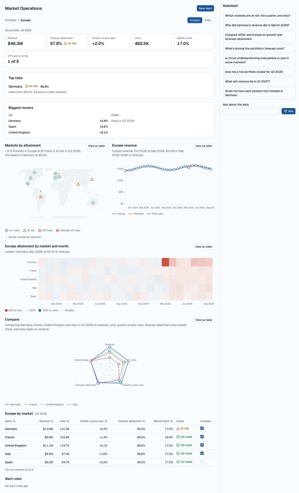
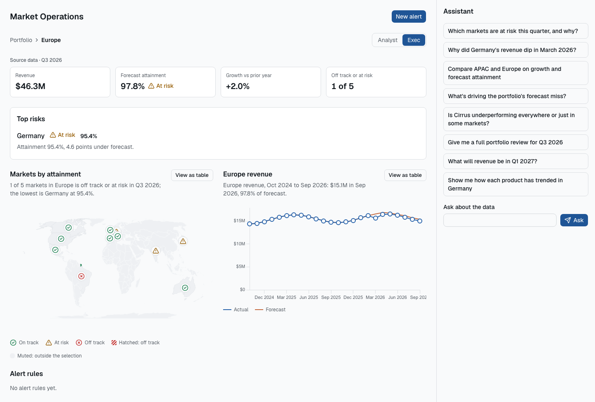
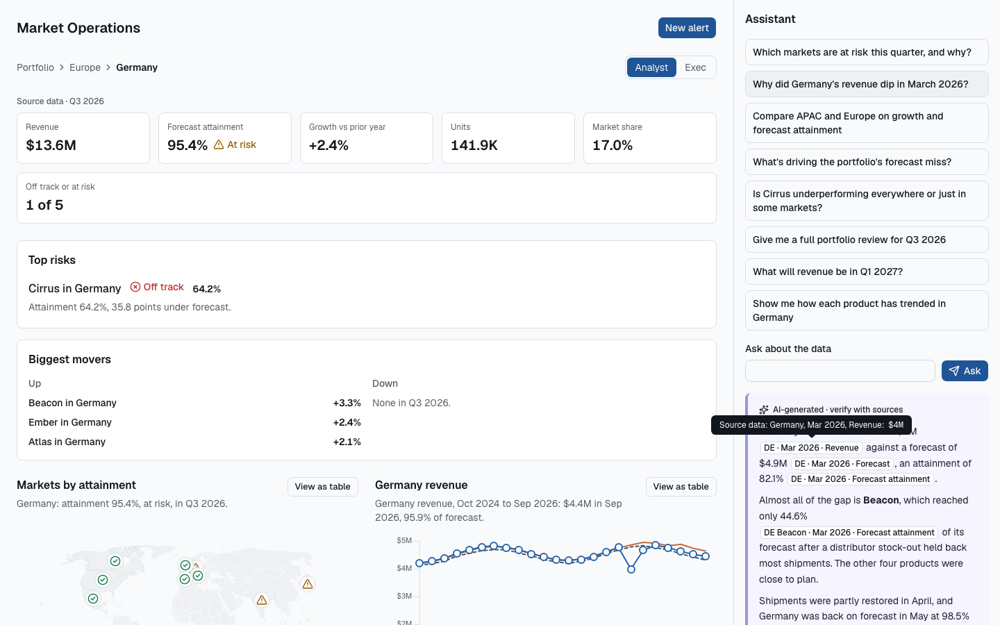
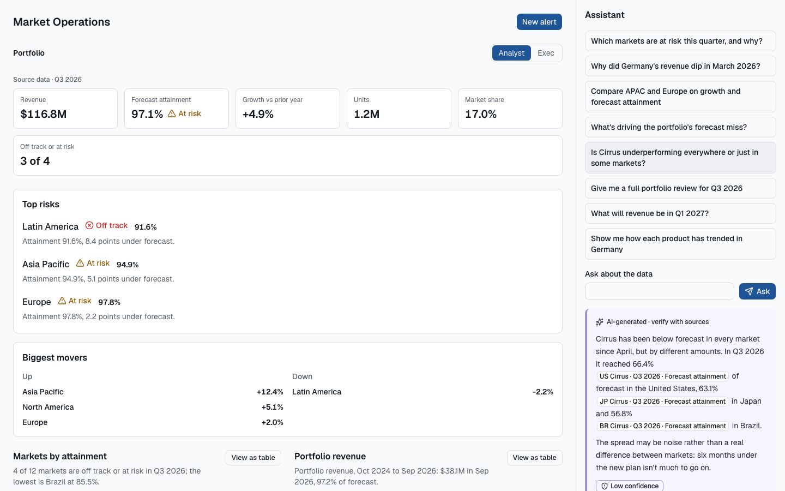
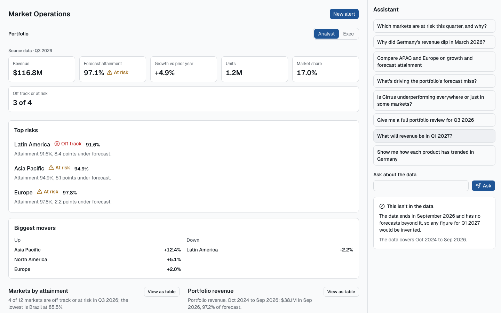
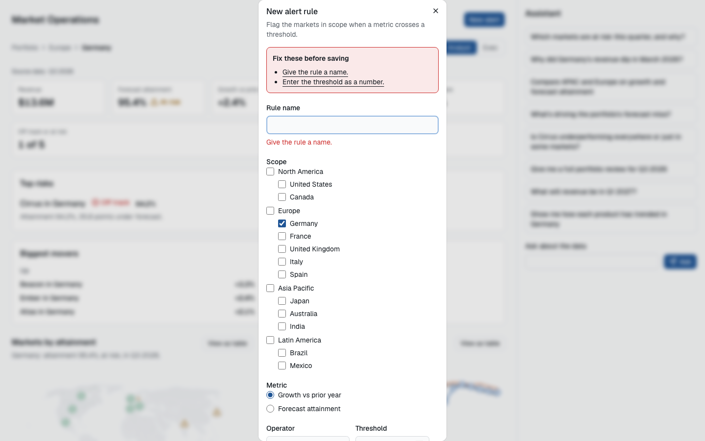
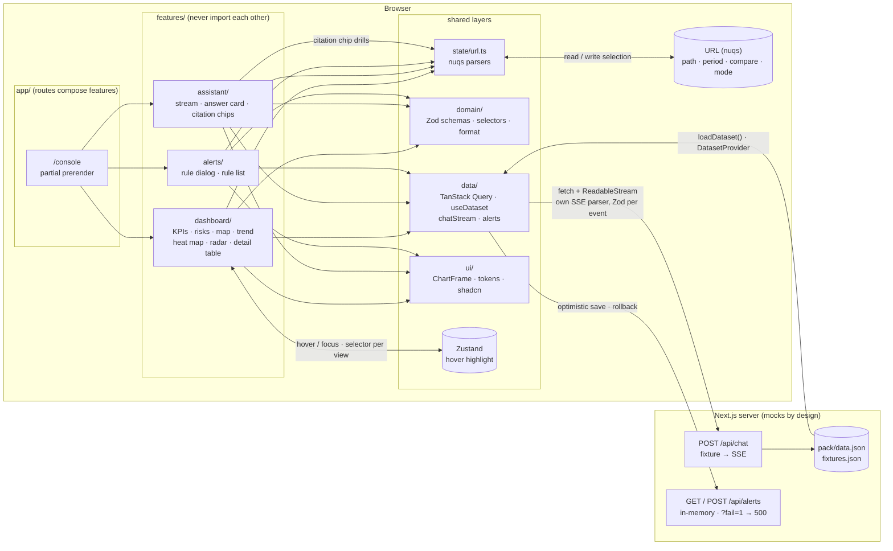

# Market Operations console

A Market Operations console featuring a streaming assistant and a dense analytical dashboard allowing a commercial operations team to track a portfolio of products and gauge performance against forecast.

Answers from the streaming assistant provide citations in order to strengthen users' confidence, allowing them to drill down into the relevant dashboard directly by clicking on the data being cited.

**Live:** https://moc.bays.me



| | |
| --- | --- |
|  |  |
|  |  |
|  | |


## a. Setup

```bash
nvm use            # Node 24 (.nvmrc)
corepack enable    # pnpm version comes from packageManager in package.json
pnpm install
pnpm dev           # http://localhost:3000/console
```

| Command | What it does |
| --- | --- |
| `pnpm typecheck` | `next typegen && tsc --noEmit` |
| `pnpm lint` | ESLint, including the layer-boundary rules |
| `pnpm format:check` | Prettier with Tailwind class sorting |
| `pnpm test` | Vitest: unit, component and integration (jsdom, MSW) |
| `pnpm test:e2e` | Playwright on Chromium and WebKit, with axe scans |
| `pnpm build` | Production build |
| `pnpm data:generate` | Regenerates `src/pack/data.json` and `fixtures.json` (seeded, deterministic) |
| `pnpm screenshots` | Regenerates the images in `docs/screenshots` |

Some things to try first:
1. Ask the assistant "Why did Germany dip?" and click one of the citation chips in the answer.
2. Toggle the "Analyst/Exec" switch to see the two different views for users with different mental models.
3. Add `?fail=1` to the URL, create and save an alert and watch the optimistic update followed by the rollback when the request fails, along with a `Retry` toast.

## b. Architecture overview

The app is split into 4 layers, each one knowing less than the one above it, enforced by ESLint's `no-restricted-paths` rule.
  1. `app`: the routes, putting features on pages. Can import anything below it.
  2. `features`: surfacing the product. e.g. Dashboard, chat assistant, alerts, navigation. Can import from shared tier and domain. Can't import another feature.
  3. `data/state/ui`: shared infrastructure. May import from domain but never feature or app. 
  4. `domain`: Business rules are pure functions, zod schemas, formatters, SSE parser, selectors 

  State management is handled depending on what it's storing:
  
  | State | Home | Why |
| --- | --- | --- |
| Selection (path, period, compare, mode) | URL, through nuqs | Allows consistent application state when sharing, bookmarking or refreshing |
| Dataset | Server, read through `useDataset` (context) | As it's currently static, no need to cache, fetch or invalidate so read through a custom hook |
| Alert rules | TanStack Query | Real server state, with optimistic saves and rollback |
| Derived numbers | `domain/selectors.ts` | Derived from data, not stored locally, keeping one source of truth |
| Hover highlight | Zustand | Ephemeral as no need to keep in shareable link |
| Stream buffer | Ref + `useReducer` in `useChatStream` | Allows us to batch per animation frame and avoid jank while streaming |

Using Next.js's partial pre-render, `/console` renders the shell statically and the dashboard is server-rendered and streamed in.

Initially it seemed as though a "Starter Pack" would be provided, but wasn't present so I spun up my own version of the data using a seeded data generator, fixtures, a contract and a mock SSE route. 
As it later turned out that no starter pack would be provided, this is the solution I've stuck with, with the caveat that the data may be a different shape to what was expected.

All data is served through `loadDataset()`, so swapping out the existing mock data with either a provided JSON object or a functioning backend should be a relatively trivial change.

<!-- Source: docs/architecture.mmd. Keep the two in sync. -->



## c. Productionising it
What I've added:
- `web-vitals` are reported through `useReportWebVitals`, currently logged in the console.
- Added an error boundary per chart that resets whenever a selection is changed to avoid one broken chart hindering any of the others.
- To avoid jank when streaming answers from chat, token updates are batched per animation frame and only the markdown block that is still streaming is re-rendered.
- Choropleth map is lazy-loaded as it's the largest asset on the page and it's lower down in the view so no need to immediately render it, so LCP can be improved.
- Used GitHub Actions to run CI on every PR which includes typechecking, linting, formatting, running all tests (unit & e2e with axe) and build.

Moving forward, more things to add:
- Error tracking with a tool like Sentry, with tagged events for easier grouping e.g. stream failures
- Move `web-vitals` reporting from console logging to a real RUM endpoint
- Bolster CSP and headers through `headers` in next.config.ts

## d. Front-end approach and decisions

### Framework

Opted for Next.js 16 with React 19. Being able to use server components to load the dataset (albeit a static one for now) and route handlers to host the mock stream offered exactly what was needed. An alternative could have been TanStack Start, which offers type-safe URL state and works nicely with TanStack Query, or React Router/Remix which is simpler but loses partial pre-render and server components are less established than in Next.

### Component library and design tokens

Chose shadcn on Radix because that way we own the code and get great a11y out of the gate with keyboard and ARIA behaviour. Tailwind with CSS variable tokens keep colours in both UI and charts aligned and tokens.test.ts checks contrast to keep everything accessible. During the build Axe found a few contrast failures at build time which were then fixed by updating tokens.

### Streaming

`fetch` with `ReadableStream` and a custom SSE parser with every event validated using Zod. Opting for something like Vercel AI SDK has worked well for me in the past, but this approach offered more granular control over the contract, which was specifically mentioned in the original brief. EventSource only sends GET requests so any questions would have to go in the URL or we'd need two endpoints, it also doesn't expose HTTP status so errors and dropped connections look the same and automatically try to reconnect, which is less ideal for one-off questions.

### Making AI output trustworthy

- Citation chip shows the real value from the dataset, clicking it drills into the dashboard.
- Confidence levels are provided by the SSE response and displayed as a labelled badge with an icon and text, with a note showing the reason for confidence levels if provided in the response (shown on "Is Cirrus underperforming..." example question).
- If the Assistant abstains from an answer it shows an abstention card that isn't treated as an error.
- AI content is marked as such, with a title in the distinctly-coloured card and the "AI Sparkle" icon, alongside a note of "verify with sources".

### Data visualisation

- visx for the trend, radar and heatmap as higher level libraries like Recharts would have involved more of a struggle to control coordinated selection and custom keyboard focus. Map uses d3-geo and topojson-client as react-simple-maps proved to be less than ideal when it came to navigating the countries using the keyboard; a user would have had to tab through _all_ countries on the map which seemed fairly inaccessible.

- Went for Heat Map over Scatter as it shows when things went wrong across markets with a varying scale, which is less obvious on the other charts like the map which just shows a status. 

### Client and server state

Initially started handling the dataset in TanStack Query and having it `"use cache"` and avoid hydrating it from the client by adding a queryFn that threw an error, but while this was handy at showing how hydration works it didn't show why we'd actually use it. Changed my mind and went for `useDataset` following the YAGNI principle. If and when the data source changed, we could easily update.

### Coordinated views and URL state

Used nuqs to hold `path`, `period`, `compare` and `mode`. Drilling into dashboard from citations pushes to history, so browser chrome navigation works. Updating period, comparison or mode replaces history because they're not navigation events. Unknown paths fall back to portfolio with a toast and clean the unknown value from the URL. Hover and focus highlight the same entity across components for emphasis and are handled by Zustand.

### Forms and validation

React Hook Form and Zod for the alert form and the API route. Threshold range depends on the metric selected (growth/attainment) as a cross-field rule. Values are checked on the server as we can't trust client defined options. Optimistically updates and rolls back if saving fails.

### Formatting for a multi-market audience

Formatting is handled in `domain/format.ts`, opted for a fixed en-US locale and USD as the currency as multi-currency introduces a whole new range of choices and issues, so that would be a stretch goal to implement at a later date. 
If we used the user's locale we'd face hydration issues or immediately lose the benefits of SSR for any actual values, so didn't want to jump the gun there. If we wanted to go for per-user locale, we could nest any values inside `<Suspense>` and stream the user-specific values in once we receive the locale string, or alternatively we could have locale defined as part of a user's configuration so not having to rely on `Accept-Language` header.

## e. Accessibility

Used `eslint-plugin-jsx-a11y` for linting and Axe as part of e2e tests in CI. Charts all have a toggle to "View as table", text summaries and everything is navigable by keyboard using a roving tabindex. Status is always represented by text as well as an icon. Focus moves to the `Key figures` component after drilling into the dashboard and Esc jumps up a level. 

Added `prefers-reduced-motion` media query to remove animations.

## f. Testing

- **Unit:** all selectors, formatters, parsers and schemas.
- **Component:** state behaviour, interactions and URL changes. Used MSW for the network.
- **E2E:** Playwright for the citation flow, drilling into dashboard, comparing before/after reloads and alert rollback as well as a11y scans using axe.

Followed TDD approach at seams, skipped snapshot testing as it adds a lot of overhead for little gain compared to interaction-based testing with e2e tests.

## g. Key technical decisions

1. Storing state in URL as the only link between views, with distinct homes for different kinds of state depending on the needs.
2. Using rounded displayed values to decide which status badge to show to avoid decimal-point inconsistencies between status badge and percentage.
3. Dataset provided through context in lieu of a real API and instead only using TanStack Query for actual data that changes i.e. Alert form

## h. Engineering standards

Strict TS; no `any` or unsafe casts. Zod at every boundary, lint-enforced boundaries between layers, css values defined as design tokens, jsx-a11y recommended settings, and feature-branch-based PRs with passing CI required.

## i. How I used AI tools

Utilised Claude Code to implement, with a workflow that started by defining `docs/PLAN.md` and fleshing out `CLAUDE.md` for rules that were established along the way. Both are committed as evidence of what was decided and how the process looked. 

Planned before each block of work, used skills to grill me on decisions and to build out functionality following TDD approach, used parallel sub-agents in worktrees for work that could be split up. Used two contrasting review skills for each PR which often found similar bugs but at times each identified unique quirks that the other had missed. Manually reviewed all PRs myself too. I pushed and merged everything myself as Claude Code is run within a sandbox environment with carefully controlled access to CLI tools.

I try to keep features to a managable size, changing hundreds of files at once leads to unmanagable pull-request reviews. 

If I'm not entirely sure why something has been suggested I'll drill into it more deeply, either asking for clarification or cited sources, or I'll research independently. 

I also try to avoid compounding dependency issues, which agents can lean on fairly readily, like pnpm filling `overrides` with overly specific version numbers.

## j. What I'd do differently with more time

Would build a live mode, a virtualised table to handle huge amounts of data, context-aware assistant and Storybook. Fuzzier question matching would be great, although in reality that would be handled by an agentic API. Per-user locale and real observability.
